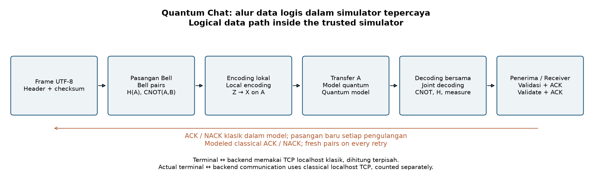

# Quantum Chat

[](https://github.com/87jbzyzr9h-gif/Quantum-Chat/actions/workflows/ci.yml)
[](LICENSE)

**Simulator lokal superdense coding yang dapat direproduksi, dengan chat terminal
dua arah, viewer observer, dan notebook ilmiah yang dapat dieksekusi.**

Versi **0.1.1 — pratinjau riset**. [English](README.md).
Dokumentasi lengkap tersedia dalam kedua bahasa. Notebook, diagram, bantuan,
dan pesan terminal menampilkan Bahasa Indonesia dan English berdampingan.

Proyek ini menyimulasikan protokol Bennett–Wiesner memakai Cirq/qsimcirq.
Qubit A yang terenkode harus tiba di penerima sebelum decoding bersama B.
Server memakai **TCP localhost klasik untuk mengontrol simulator**; server
tidak mengirim qubit fisik. Tidak ada klaim komunikasi lebih cepat dari cahaya,
sinyal melalui entanglement saja, enkripsi quantum, QML, atau rekonstruksi
dengan pre-shared key.

## Notebook ilmiah

| Notebook | Penjelasan dan komputasi aktual |
|---|---|
| [01 · Superdense coding](notebooks/01_superdense_coding.ipynb) | Persiapan Bell, encoding Z/X, diagram circuit, state tereduksi dan verifikasi empat simbol |
| [02 · Protokol chat](notebooks/02_quantum_chat_protocol.ipynb) | Diagram arsitektur, frame UTF-8, pesan dua arah, perhitungan sumber daya dan uji dengan noise |
| [03 · Observer dan noise](notebooks/03_observer_and_noise.ipynb) | State, koherensi, matriks densitas, ensemble berisik eksak dan histogram aktual qsim |

Notebook menyertakan keluaran eksekusi dan assertion. Isinya menjelaskan
protokol yang sudah dikenal; proyek ini bukan penemuan kanal baru yang telah
ditinjau sejawat.



## Instalasi

Gunakan **Python 3.12** pada macOS atau Linux dengan wheel qsimcirq yang
kompatibel. Versi dependensi dikunci. Windows belum divalidasi.

```sh
git clone https://github.com/87jbzyzr9h-gif/Quantum-Chat.git
cd Quantum-Chat
python3.12 -m venv .venv
source .venv/bin/activate
python -m pip install --only-binary=:all: -r requirements.txt
python -m pip install --no-deps .
```

Dependensi runtime adalah `cirq-core`, `qsimcirq`, dan `numpy`. `cirq-core`
menyediakan import `cirq` tanpa integrasi penyedia hardware yang tidak dipakai.
Untuk memasang alat notebook dan pengembangan:

```sh
python -m pip install -e '.[notebooks,dev]'
jupyter lab
```

Buka notebook secara berurutan dengan kernel Python dari environment ini.
Eksekusi notebook tidak memerlukan API key, unduhan dataset, atau pelatihan
model. Instalasi awal memerlukan internet.

## Chat terminal

```sh
python chat.py
# Perintah setelah instalasi: quantum-chat
```

Ketik pesan; `/as Mars` mengubah pengirim dalam mode demo. `/history`
menampilkan pesan diterima, `/stats` menampilkan sumber daya, dan `/quit`
keluar. Untuk satu pesan: `python chat.py --message 'Hai! Apa kabarmu hari ini'`.

Untuk dua peserta, gunakan tiga terminal dalam environment/direktori yang sama:

```sh
# Terminal server
python chat.py --server
# Terminal Bumi
python chat.py --name Bumi
# Terminal Mars
python chat.py --name Mars
```

Kedua klien harus tersambung sebelum bertukar pesan. Server hanya bind ke
`127.0.0.1:8765`; ubah `--port` pada ketiga proses bila perlu. Tidak ada
autentikasi/enkripsi: jangan jadikan layanan publik. Logging mati secara
bawaan. `--server --log PATH` secara eksplisit menyimpan teks chat.

| Perintah | Tindakan |
|---|---|
| Teks biasa / baris kosong | Kirim teks UTF-8, termasuk pesan kosong |
| `/as Bumi` atau `/as Mars` | Ganti pengirim khusus dalam demo |
| `/history`, `/stats` | Riwayat / biaya model quantum dan TCP secara terpisah |
| `/send TEXT` | Kirim teks berawalan slash, misalnya `/send /quit` |
| `/help`, `/quit` | Bantuan / keluar |

Batas pesan: 4096 byte UTF-8. Riwayat/deduplikasi hanya berlaku dalam satu sesi.
Nama perintah, flag, status `CONFIRMED`/`UNCONFIRMED`, dan field JSON adalah
identifier teknis yang sama dalam kedua bahasa; penjelasannya bilingual.

## Viewer observer

```sh
python viewer.py --bits 11 --step
python viewer.py --message 'Hai!' --pairs 1 --step
python viewer.py --all-symbols --shots 32
python viewer.py --bits 11 --noise 0.1 --shots 100
python viewer.py --message 'Hai!' --scope frame --json results/trace.json
# Perintah setelah instalasi: quantum-viewer
```

Ini **replay observer independen**, bukan pemantau langsung server. State
global hanya milik observer diagnostik, bukan penerima chat. State berisik
memakai matriks densitas eksak; histogram memakai run qsim satu shot yang
independen. Verifikasi frame dan replay pasangan yang ditampilkan adalah
run yang berbeda.

## Sumber daya, noise, dan cakupan

Setiap frame memuat header 15 byte, payload UTF-8, dan SHA-256 32 byte.
Setiap simbol dua bit memakai pasangan Bell baru, B yang didistribusikan
lebih dahulu, serta A yang dikirim. ACK/NACK memakai 75 byte klasik.
Semua percobaan ulang dihitung. `model_forward_classical_bits=0` hanya
menjelaskan payload quantum dalam model, bukan lalu lintas kontrol localhost
klasik yang sebenarnya.

Contoh 25 byte menghasilkan frame 72 byte: 288 pasangan Bell, 288 transfer A,
288 distribusi awal B, dan 600 bit ACK per percobaan ideal. Overhead ikut
dihitung; ini bukan rekonstruksi dari hint 1–4 byte.

```sh
python chat.py --demo --noise 0.002 --ack-noise 0.0002 --attempts 5
```

`--noise` adalah depolarisasi per A yang dikirim; `--ack-noise` membalik bit
ACK klasik secara independen. Untuk klien tersambung, atur pada server.
`CONFIRMED` memerlukan ACK yang cocok. `UNCONFIRMED` dapat terjadi sesudah
penerima menerima frame. Percobaan ulang tidak menggandakan pesan diterima.

Persiapan Bell, distribusi B, penyimpanan, dan gate lokal selain itu ideal.
Latensi hardware, erasure, toleransi kesalahan, dan enkripsi tidak dimodelkan.
SHA-256 mendeteksi kerusakan tak sengaja, bukan keaslian peserta.

## Reproduksi

```sh
python -m unittest discover -s tests -v
python verify_chat.py
python scripts/execute_notebooks.py --output work/executed-notebooks
python -m build
```

Tes mencakup klien loopback aktual, empat simbol, UTF-8, frame rusak, ACK
hilang, percobaan ulang, dan ensemble viewer. `verify_chat.py` menulis hasil
aktual 100 uji ideal serta 100 uji berisik. Keluaran dihitung, bukan direka.
Lihat [arsitektur](docs/architecture.id.md), [teori](docs/theory.id.md),
[metodologi](docs/reproducibility.id.md), [kontribusi](CONTRIBUTING.id.md),
[proses rilis](docs/release_process.id.md), dan [catatan perubahan](CHANGELOG.id.md).

## Sitasi dan referensi

Gunakan [CITATION.cff](CITATION.cff) untuk software ini dan kutip protokol asli:

1. Bennett, C. H. & Wiesner, S. J. (1992). *Communication via one- and
   two-particle operators on Einstein-Podolsky-Rosen states*. Physical Review
   Letters 69, 2881. [doi:10.1103/PhysRevLett.69.2881](https://doi.org/10.1103/PhysRevLett.69.2881).
2. [IBM Quantum: superdense coding](https://quantum.cloud.ibm.com/learning/en/courses/basics-of-quantum-information/entanglement-in-action/superdense-coding).
3. [IBM Quantum: state tereduksi](https://quantum.cloud.ibm.com/learning/en/courses/general-formulation-of-quantum-information/density-matrices/multiple-systems).
4. [Google Quantum AI: qsimcirq](https://quantumai.google/qsim/tutorials/qsimcirq).

[Referensi BibTeX](docs/references.bib). Lisensi MIT; lihat [LICENSE](LICENSE)
dan [terjemahan Indonesia](LICENSE.id.md). Tidak ada klaim dukungan institusi
atau DOI software.
