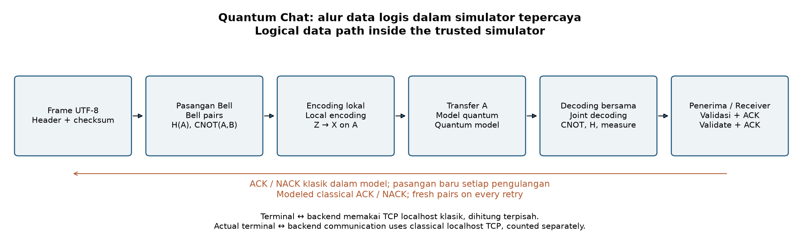

# Quantum Chat

[](https://github.com/87jbzyzr9h-gif/Quantum-Chat/actions/workflows/ci.yml)
[](LICENSE)

**A reproducible local superdense-coding simulator with two-way terminal chat,
an observer viewer, and executable scientific notebooks.**

Version **0.1.1 — research preview**. English | [Bahasa Indonesia](README.id.md).
Full documentation is available in both languages. Notebooks, diagrams, help,
and terminal messages display Indonesian and English side by side.

This project simulates the Bennett–Wiesner protocol using Cirq/qsimcirq.
An encoded A qubit must reach the receiver before joint decoding with B.
The server uses **classical localhost TCP to control the simulator**; it does
not send physical qubits. No faster-than-light communication, entanglement-only
signalling, quantum encryption, QML or pre-shared-key reconstruction is claimed.

## Scientific notebooks

| Notebook | Explanation and actual computation |
|---|---|
| [01 · Superdense coding](notebooks/01_superdense_coding.ipynb) | Bell preparation, Z/X encoding, circuit diagrams, reduced states and four-symbol verification |
| [02 · Chat protocol](notebooks/02_quantum_chat_protocol.ipynb) | Architecture diagram, UTF-8 frames, two-way messages, resource accounting and noisy trials |
| [03 · Observer and noise](notebooks/03_observer_and_noise.ipynb) | States, coherence, density matrices, exact noisy ensembles and actual qsim histograms |

Notebooks include executed outputs and assertions. They explain established
protocols; this project is not a peer-reviewed discovery of a new channel.



## Install

Use **Python 3.12** on macOS or Linux with a compatible qsimcirq wheel.
Dependency versions are pinned. Windows has not been validated.

```sh
git clone https://github.com/87jbzyzr9h-gif/Quantum-Chat.git
cd Quantum-Chat
python3.12 -m venv .venv
source .venv/bin/activate
python -m pip install --only-binary=:all: -r requirements.txt
python -m pip install --no-deps .
```

Runtime dependencies are `cirq-core`, `qsimcirq` and `numpy`. `cirq-core`
supplies the `cirq` import without unused hardware-provider integrations.
To install notebook and development tools:

```sh
python -m pip install -e '.[notebooks,dev]'
jupyter lab
```

Open the notebooks in order using this environment's Python kernel. Notebook
execution needs no API key, dataset download or model training. Initial
installation needs internet.

## Terminal chat

```sh
python chat.py
# Installed console command: quantum-chat
```

Type a message; `/as Mars` changes the sender in demo mode. `/history` shows
received messages, `/stats` shows resources, and `/quit` exits.
For one message: `python chat.py --message 'Hai! Apa kabarmu hari ini'`.

For two participants, use three terminals in the same environment/directory:

```sh
# Server terminal
python chat.py --server
# Bumi terminal
python chat.py --name Bumi
# Mars terminal
python chat.py --name Mars
```

Both clients must connect before exchanging messages. The server binds only
to `127.0.0.1:8765`; change `--port` on all three processes if needed.
There is no authentication/encryption: do not expose it as a public service.
Logging is off by default. `--server --log PATH` explicitly saves chat text.

| Command | Action |
|---|---|
| Plain text / empty line | Send UTF-8 text, including an empty message |
| `/as Bumi` or `/as Mars` | Switch sender in demo only |
| `/history`, `/stats` | History / quantum model and separate TCP resource counts |
| `/send TEXT` | Send slash-prefixed text, e.g. `/send /quit` |
| `/help`, `/quit` | Help / exit |

Message limit: 4096 UTF-8 bytes. History/deduplication are session-only.
Commands, flags, `CONFIRMED`/`UNCONFIRMED` statuses, and JSON fields are shared
technical identifiers in both languages; their explanations are bilingual.

## Observer viewer

```sh
python viewer.py --bits 11 --step
python viewer.py --message 'Hai!' --pairs 1 --step
python viewer.py --all-symbols --shots 32
python viewer.py --bits 11 --noise 0.1 --shots 100
python viewer.py --message 'Hai!' --scope frame --json results/trace.json
# Installed console command: quantum-viewer
```

This is an **independent observer replay**, not a live server tap. Global
states belong only to the diagnostic observer, never the chat receiver.
Noisy states use exact density matrices; histograms use independent one-shot
qsim runs. Frame verification and displayed-pair replay are separate runs.

## Resources, noise and scope

Each frame contains a 15-byte header, UTF-8 payload and 32-byte SHA-256.
Each two-bit symbol consumes a fresh Bell pair, pre-distributed B, and
transmitted A. ACK/NACK uses 75 classical bytes. All retries are counted.
`model_forward_classical_bits=0` describes only the modeled quantum payload,
never actual classical localhost control traffic.

The 25-byte example has a 72-byte frame: 288 Bell pairs, 288 A transfers,
288 initial B distributions and 600 ACK bits per ideal attempt. Overhead
is included; this is not reconstruction from a 1–4-byte hint.

```sh
python chat.py --demo --noise 0.002 --ack-noise 0.0002 --attempts 5
```

`--noise` is depolarization per transmitted A; `--ack-noise` flips classical
ACK bits independently. Set them on the server for connected clients.
`CONFIRMED` requires a matching ACK. `UNCONFIRMED` can occur after the receiver
accepted the frame. Retries do not duplicate an accepted message.

Bell preparation, B distribution, storage and local gates are otherwise ideal.
No hardware latency, erasure, fault tolerance or encryption is modeled.
SHA-256 detects accidental corruption, not peer authenticity.

## Reproduce

```sh
python -m unittest discover -s tests -v
python verify_chat.py
python scripts/execute_notebooks.py --output work/executed-notebooks
python -m build
```

Tests cover actual loopback clients, all four symbols, UTF-8, corrupted
frames, ACK loss, retry and viewer ensembles. `verify_chat.py` writes actual
100-trial ideal and 100-trial noisy results. Outputs are computed, not invented.
See [architecture](docs/architecture.md), [theory](docs/theory.md),
[methodology](docs/reproducibility.md), [contributing](CONTRIBUTING.md),
[release process](docs/release_process.md), and [changelog](CHANGELOG.md).

## Citation and references

Use [CITATION.cff](CITATION.cff) for this software and cite the original protocol:

1. Bennett, C. H. & Wiesner, S. J. (1992). *Communication via one- and
   two-particle operators on Einstein-Podolsky-Rosen states*. Physical Review
   Letters 69, 2881. [doi:10.1103/PhysRevLett.69.2881](https://doi.org/10.1103/PhysRevLett.69.2881).
2. [IBM Quantum: superdense coding](https://quantum.cloud.ibm.com/learning/en/courses/basics-of-quantum-information/entanglement-in-action/superdense-coding).
3. [IBM Quantum: reduced states](https://quantum.cloud.ibm.com/learning/en/courses/general-formulation-of-quantum-information/density-matrices/multiple-systems).
4. [Google Quantum AI: qsimcirq](https://quantumai.google/qsim/tutorials/qsimcirq).

[BibTeX references](docs/references.bib). MIT licensed; see [LICENSE](LICENSE) and the [Indonesian translation](LICENSE.id.md).
No institutional endorsement or software DOI is implied.
