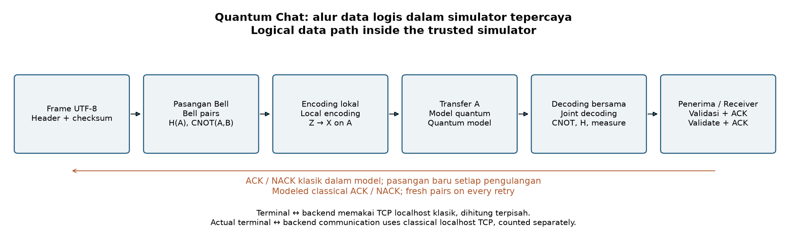
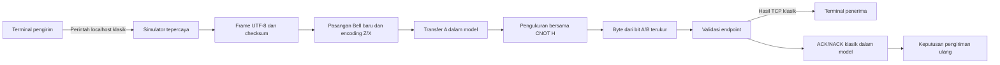

# Arsitektur dan batas data

[English](architecture.md) | Bahasa Indonesia

Gambar dibuat oleh notebook 02 dan tersedia sebagai artefak terpisah.

Backend memiliki circuit simulasi lengkap. Terminal frontend mengirim perintah
kontrol klasik; tidak terjadi distribusi quantum fisik. `QuantumChannel.transmit`
membangun byte keluaran hanya dari pengukuran qsim. `Endpoint.receive` melihat
byte ini, bukan teks pengirim, pilihan encoding, atau state global. Pemisahan
modul adalah batas data ilmiah, bukan isolasi proses terhadap penyerang.
Simulator tepercaya memang memiliki pesan masukan.

| Modul | Tanggung jawab |
|---|---|
| `densechat/quantum.py` | Persiapan Bell, encoding, perpindahan kepemilikan A, pengukuran satu shot |
| `densechat/protocol.py` | Frame UTF-8 berbatas, panjang/sequence, SHA-256, pengikatan ACK |
| `densechat/session.py` | Endpoint, deduplikasi, percobaan ulang, dan catatan sumber daya |
| `densechat/server.py` | Server kontrol loopback klasik dan penghitung byte TCP aktual |
| `densechat/cli.py` | Demo dan peserta terminal |
| `viewer.py` | Replay observer independen dengan akses diagnostik |

Frame diterima bisa kehilangan ACK: `received=True, confirmed=False`. Hanya
ACK kembali yang cocok menghentikan pengiriman ulang. Pengulangan dengan
sequence/fingerprint sama tidak menambah riwayat; isi berbeda dengan sequence
sama ditolak. State bertahan selama satu sesi server.

Penerima memeriksa checksum, versi, ukuran yang dinyatakan, dan UTF-8 sebelum
menerima. Ukuran teks maksimum 4096 byte. SHA-256 tanpa kunci mendeteksi
kerusakan tak sengaja; ini bukan autentikasi peserta.

Untuk panjang frame L byte dan R percobaan, biaya model adalah 4LR pasangan
Bell, 4LR transfer A, 4LR distribusi awal B, dan 600R bit ACK/NACK klasik.
Lalu lintas JSON/TCP aktual dihitung terpisah. Statistik merupakan snapshot
sebelum balasan saat ini; tidak ada klaim keunggulan atas kanal kontrol klasik.
