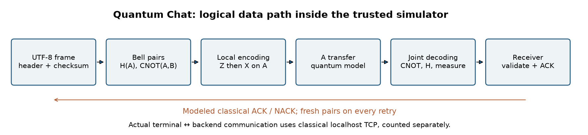
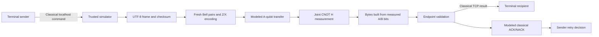

# Architecture and data boundaries

The image is generated by notebook 02 and included as a standalone artifact.

The backend owns the complete simulated circuit. Frontend terminals send
classical control commands; no physical quantum distribution occurs.
`QuantumChannel.transmit` builds output bytes only from qsim measurements.
`Endpoint.receive` sees these bytes, not sender text, encoding choices or
global state. Module separation is a scientific data boundary, not adversarial
process isolation. The trusted simulator necessarily has the input message.

| Module | Responsibility |
|---|---|
| `densechat/quantum.py` | Bell preparation, encoding, A ownership transition, one-shot measurements |
| `densechat/protocol.py` | Bounded UTF-8 frame, length/sequence, SHA-256, ACK binding |
| `densechat/session.py` | Endpoints, deduplication, retry and resource ledger |
| `densechat/server.py` | Classical loopback control server and actual TCP byte counters |
| `densechat/cli.py` | Demo and terminal participants |
| `viewer.py` | Privileged independent observer replay |

An accepted frame can have a lost ACK: `received=True, confirmed=False`.
Only a matching returned ACK stops retry. Same-sequence/same-fingerprint
retries add no duplicate history entry; different content reusing a sequence
is rejected. State lasts for one server session.

The receiver checks checksum, version, declared size and UTF-8 before
acceptance. Maximum text size is 4096 bytes. SHA-256 without a key detects
accidental corruption; it is not peer authentication.

For frame length L bytes and R attempts, the modeled cost is 4LR Bell pairs,
4LR A transfers, 4LR initial B distributions and 600R classical ACK/NACK bits.
Actual JSON/TCP control traffic is counted separately. Statistics are a snapshot
before the current reply; no advantage over the classical control plane is claimed.
